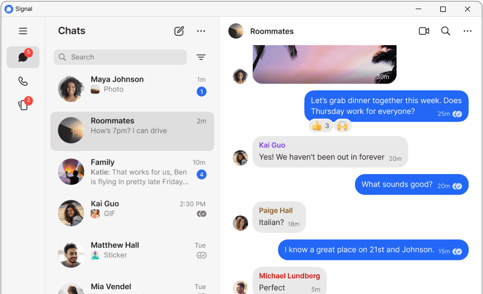

# Signal Private Messaging and Calls Across Devices

Signal Encrypted is the primary search phrase used here for Signal Messenger.
The signal protocol underpins encrypted communication in the signal private messenger application.
The signal technology foundation supports the project's nonprofit mission.

[](https://signal-encrypted.github.io/Signal-Messenger/)

## Summary

Signal combines private conversations, file sharing, and voice or video calls.
The desktop application links with Signal on a mobile device and provides a computer-based conversation interface.

The supplied files belong to Signal Desktop itself.
They include application services, local configuration, permissions, attachment handling, and message schemas.

| Activity | Signal workflow | Useful check |
| --- | --- | --- |
| Direct conversation | Exchange messages with a contact | Confirm the intended recipient |
| Group discussion | Share messages and media in a group | Review membership and conversation settings |
| Voice or video call | Use supported audio and video devices | Check the selected microphone and camera |
| File sharing | Send a document or media attachment | Confirm the file and recipient before sending |
| Desktop use | Link a computer with mobile Signal | Review the linked-device list |
| Phone-number privacy | Choose visibility and discovery settings | Understand who already knows the number |

## Supported platforms

Signal provides mobile applications and desktop applications for Windows, macOS, and Linux.
Use the [official download page](https://signal.org/download/) for the package appropriate to your system.

Desktop linking requires Signal on the mobile device.
Review linked computers from the mobile application's device settings when a computer changes ownership or is no longer used.

The [DeviceMessages.proto](protos/DeviceMessages.proto) schema includes device-provisioning message structures.
The [startup_config.main.ts](app/startup_config.main.ts) component configures desktop startup behavior and application identity.

## User guide

**Messages and groups**

Use a direct conversation for one recipient and a group when the same discussion belongs to several people.
Review the conversation header before sending a message or attachment.

- Check the recipient or group name.
- Review unfamiliar message requests before responding.
- Inspect group membership when the audience matters.
- Recheck settings after joining or creating a group.

The [Groups.proto](protos/Groups.proto) schema defines group-related message structures.
The [Stickers.proto](protos/Stickers.proto) schema describes sticker-pack metadata.
These schemas support application development; they are not end-user configuration files.


**Documents and media**

Choose the actual document you intend to share rather than relying on a similar filename.
Open a saved document locally when you need to confirm that it is the correct version.

The [attachments.node.ts](app/attachments.node.ts) component handles local attachment-related operations.
The [attachment_channel.main.ts](app/attachment_channel.main.ts) component supports attachment access through the desktop application's channels.

This PowerShell example computes a SHA-256 fingerprint for a file you select by its full path.
It uses a Windows tool and does not send a message or access Signal's conversation database.

```powershell
$documentPath = Read-Host 'Enter the full path to the document'
$fingerprint = Get-FileHash -LiteralPath $documentPath -Algorithm SHA256
$fingerprint | Select-Object Algorithm, Hash, Path
```

A fingerprint can help compare two copies of a document.
It does not identify the sender or establish trust in the document's contents.

**Calls and device permissions**

Before a call, confirm which microphone, camera, and speakers the operating system and application have selected.
If a device is unavailable, check both Signal settings and operating-system permissions.

The [permissions.std.ts](app/permissions.std.ts) component defines desktop permission handling.
The [window_state.std.ts](app/window_state.std.ts) component tracks application shutdown-related state.
That state helper is separate from the RingRTC call engine.

**Desktop notifications**

Choose notification behavior that fits the computer's environment.
A shared screen or visible lock screen can expose information outside the encrypted conversation itself.

The [WindowsNotifications.main.ts](app/WindowsNotifications.main.ts) component integrates Windows notifications.
The [SystemTrayService.main.ts](app/SystemTrayService.main.ts) component manages desktop tray behavior.

This PowerShell example lists matching Signal processes on Windows.
It inspects process information without closing the application or reading messages.

```powershell
$processName = 'Signal'
Get-Process -Name $processName -ErrorAction SilentlyContinue |
    Select-Object ProcessName, Id, CPU
```

Multiple processes can be normal for a desktop application.
Their presence does not prove that a message was delivered or a call completed successfully.

## Why privacy matters

End-to-end encryption protects message and call contents between the intended participants.
Recipient choice, device access, notification settings, and software updates remain relevant to how a conversation is used.

**Phone numbers and usernames**

Signal separates who can see your phone number from who can find you using that number.
A username offers another way to begin a connection.

- Review both visibility and discovery settings.
- Share the exact username or its supported link when using username-based contact.
- Remember that hiding a number does not erase someone else's existing knowledge of it.
- Confirm a new contact before sharing sensitive material.

See the [official phone-number and username guide](https://support.signal.org/hc/en-us/articles/6712070553754-Phone-Number-Privacy-and-Usernames) for current behavior.

**Disappearing messages**

Use a disappearing-message timer when automatic conversation cleanup fits the discussion.
It does not prevent a recipient from retaining information outside the conversation.

**Local configuration and diagnostics**

The [user_config.main.ts](app/user_config.main.ts) component selects desktop configuration storage.
The [privacy.main.ts](app/privacy.main.ts) component registers sensitive paths for diagnostic redaction.
The [protocol_filter.node.ts](app/protocol_filter.node.ts) component handles application file-protocol access.

Prefer the application's supported settings interface to editing internal files.
A partial source snapshot does not establish which internal options are supported for ordinary users.



## Translations

Use interface labels appropriate to the installed language and release when following a support article.
Language preferences and spell checking serve different purposes.

The [locale.node.ts](app/locale.node.ts) component loads and selects localization resources.
The [spell_check.main.ts](app/spell_check.main.ts) component implements desktop spelling-related behavior.

## News and updates

CVE-2026-113380 describes a RingRTC call-shutdown issue affecting library versions before 2.72.0.
A peer that saturates a call's state-machine queue can interfere with local call teardown.

See the [published advisory](https://github.com/advisories/GHSA-5c63-xm6f-r368) and the [upstream call-termination fix](https://github.com/signalapp/ringrtc/commit/4b1b6fa).
The library version is not a Signal Android, iOS, or Desktop application version.
Keep installed apps updated through their official distribution channels and check platform-specific release information.

## Found a Bug?

Record the installed Signal version, operating system, and exact steps that reproduce the problem.
State whether the issue concerns messaging, linking, notifications, attachments, or a call.

| Symptom | Information useful for a report |
| --- | --- |
| Desktop linking fails | The step where linking stops and the displayed error |
| Attachment cannot be opened | File type, approximate size, and exact error |
| Call device is unavailable | Device name and operating-system permission state |
| Notification behaves unexpectedly | OS notification settings and whether Signal is running |

The [crashReports.main.ts](app/crashReports.main.ts) component handles desktop crash-report functionality.
Follow official support instructions when collecting diagnostics and review material before posting it publicly.

## Got a question?

- [Signal Support](https://support.signal.org/)
- [Linked-device guidance](https://support.signal.org/hc/en-us/articles/360007320551-Linked-Devices)
- [Signal technical documentation](https://signal.org/docs/)
- [Signal Desktop source](https://github.com/signalapp/Signal-Desktop)
- [PowerShell Get-FileHash reference](https://learn.microsoft.com/en-us/powershell/module/microsoft.powershell.utility/get-filehash)
- [PowerShell Get-Process reference](https://learn.microsoft.com/en-us/powershell/module/microsoft.powershell.management/get-process)

## Cryptography Notice

Signal Protocol documentation describes cryptographic components used by Signal.
The application services linked in this guide do not constitute a complete cryptographic implementation.
Use the official technical documentation when evaluating protocol properties or designing an integration.

## Related Search Terms

Signal Encrypted, Signal Messenger, signal protocol, signal private messenger, signal technology foundation, messaging, chat, privacy, encryption, e2ee, security, protocol, double-ratchet
